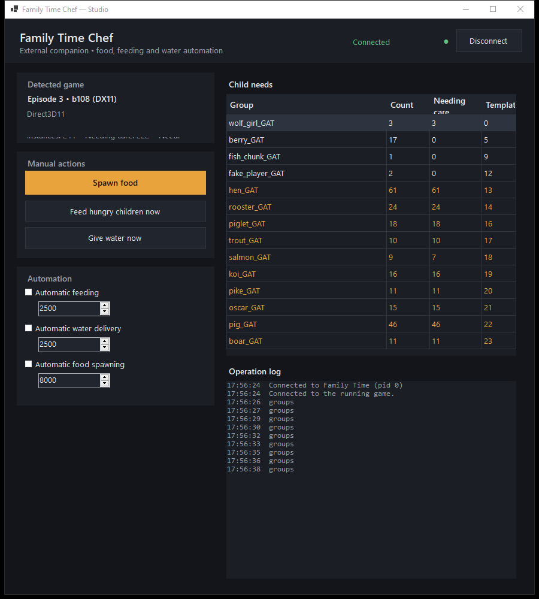

# FamilyTimeCheat

External companion tool for the colony sim **Family Time**. It reads the game's
live child-need state and can spawn food, feed hungry children and deliver water
on thirst days - manually from a GUI, or hands-off on a timer.



> **Unofficial and unaffiliated.** This project is not made by, endorsed by, or
> supported by the developers or publisher of Family Time. It contains no game
> code, assets or binaries. It is a user-operated utility that attaches to a game
> you already own. See [docs/LEGAL.md](docs/LEGAL.md) before using it.

---

## Status

| Install | Episode | Renderer | Support |
| --- | --- | --- | --- |
| `Family_Time_Ep_3_WINDOWS_DX11_b108` | 3 | DX11 | **Supported and verified in game** |
| `Family_Time_Ep_3_WINDOWS_DX12_b108` | 3 | DX12 | Detected, **unverified** |
| `FamilyTime_Patreon-DX11-Build37` | 2 | DX11 | **Supported and verified in game** |
| `FamilyTime_Patreon-DX12-Build37` | 2 | DX12 | **Supported and verified in game** |
| `FamilyTime_Patreon` | 1 | - | **Supported and verified in game** (no thirst) |

Episodes 1, 2 (DX11 and DX12) and Episode 3 DX11 have both working code and
in-game verification. Episode 3 DX12 shares the same managed API and the same
packed hunger bit, but it has not been driven, so it is listed as unverified
rather than supported. Episode 1 packs a 4-bit hunger level instead of a single
bit, and it has no thirst mechanic at all, so water is refused there by design.

What was actually measured is in [docs/COMPATIBILITY.md](docs/COMPATIBILITY.md).

## What it does

- **Live need reads** - instance count, hungry count and the active need type
  (`FOOD` or `THIRST`), read from the game's own GPU buffer each tick. Both the
  Episode 2/3 single-bit layout and the Episode 1 4-bit level layout are read.
- **Manual actions** - Spawn food, Feed, Water buttons, plus a "feed all" pass.
- **Automation** - optional timers for feeding, watering and spawning, with a
  per-child cooldown and a per-tick action budget so the frame is never blocked.
- **Operation log** - every action is confirmed by re-reading game state, so the
  GUI reports what the game did, not what the tool hoped it did.

## How it works

Hunger in Family Time is not stored in CPU memory: it is a packed bit inside a
GPU `ComputeBuffer` advanced by compute kernels. An external process cannot read
or clear it, so code has to run inside the Unity player. The design is therefore
two parts:

```
FamilyTimeChef.Studio.exe      external WinForms GUI (this process)
        │  plain-file channel in %LOCALAPPDATA%\FamilyTimeChef
        ▼
FamilyTimeChef.InGame.dll      shim injected into the running player
        │  reflection only - no compile-time reference to Assembly-CSharp
        ▼
the game's own GAT API
```

1. `ftinject.exe` calls `LoadLibrary` on `ftagent.dll` inside `FamilyTime.exe`.
2. The agent attaches to the game's existing Mono domain
   (`mono_thread_attach`) and loads the managed shim into it.
3. The shim installs a render-pipeline frame hook and does its game work on the
   first real frame - never on the injected thread.
4. The GUI talks to the shim through a token-scoped file channel.

Nothing is installed into the game folder and no game file is modified.

## Install

See [docs/INSTALL.md](docs/INSTALL.md). The short version, with the game running:

```powershell
# from the portable ZIP
.\install.ps1
& "$env:LOCALAPPDATA\FamilyTimeChef\ftinject.exe" <pid of FamilyTime.exe> `
    "$env:LOCALAPPDATA\FamilyTimeChef\ftagent.dll"
& "$env:LOCALAPPDATA\FamilyTimeChef\FamilyTimeChef.Studio.exe"
```

Injection is once per game session. The Studio also does this for you: on launch it
looks for a running `FamilyTime.exe` and loads the shim automatically, so the
manual `ftinject.exe` step is optional.

Some antivirus products flag tools that inject into another process, because the
underlying Windows calls look the same as a loader's. See
[docs/ANTIVIRUS.md](docs/ANTIVIRUS.md) for why that happens and the only
legitimate fixes (code signing, false-positive reports). This project does not
include evasion code and does not ask you to disable your scanner.

## Build

See [docs/BUILD.md](docs/BUILD.md). Requires Windows, a .NET SDK, and a C
compiler for the three small native tools. The plugin compiles against Unity
reference assemblies taken from **your own** game install; none are shipped here.

## Known limitations

- **The game pauses when it is not focused.** `Application.runInBackground` is
  inert in this build (it reads back `False` even when re-asserted every frame),
  so the tool ships a message-level WndProc shield that swallows the deactivation
  messages. With the shield installed the simulation keeps advancing while the
  game is in the background or minimized. Automation timers set inside the game
  remain the only supported automation; the `RELAX` verb's `runInBackground=1` is
  **not** claimed to have any effect.
- Episode 3 DX12 is unverified: it has not been driven, so no claim is made for it.
- Episode 1 has no thirst mechanic, so `Water` returns a refusal there instead of
  acting. Feeding and spawning work normally.
- The Studio window and the game window must not overlap if you script clicks at
  fixed coordinates (see [docs/TROUBLESHOOTING.md](docs/TROUBLESHOOTING.md)).
- Actions are gated on a recognised build; unknown builds stay read-only.

## Troubleshooting

[docs/TROUBLESHOOTING.md](docs/TROUBLESHOOTING.md), including
[docs/ANTIVIRUS.md](docs/ANTIVIRUS.md) for scanner warnings.

## Changes

[CHANGELOG.md](CHANGELOG.md).

## Legal

This is an unofficial, user-operated utility. You must own or otherwise legally
access Family Time, and you are responsible for complying with its terms of use.
Using external tools may violate those terms and may affect your save files. This
project contains no game code, assets, DRM circumvention or licence bypass, and
does not collect or transmit any data. Read [docs/LEGAL.md](docs/LEGAL.md).

## Licence

MIT - see [LICENSE](LICENSE).
